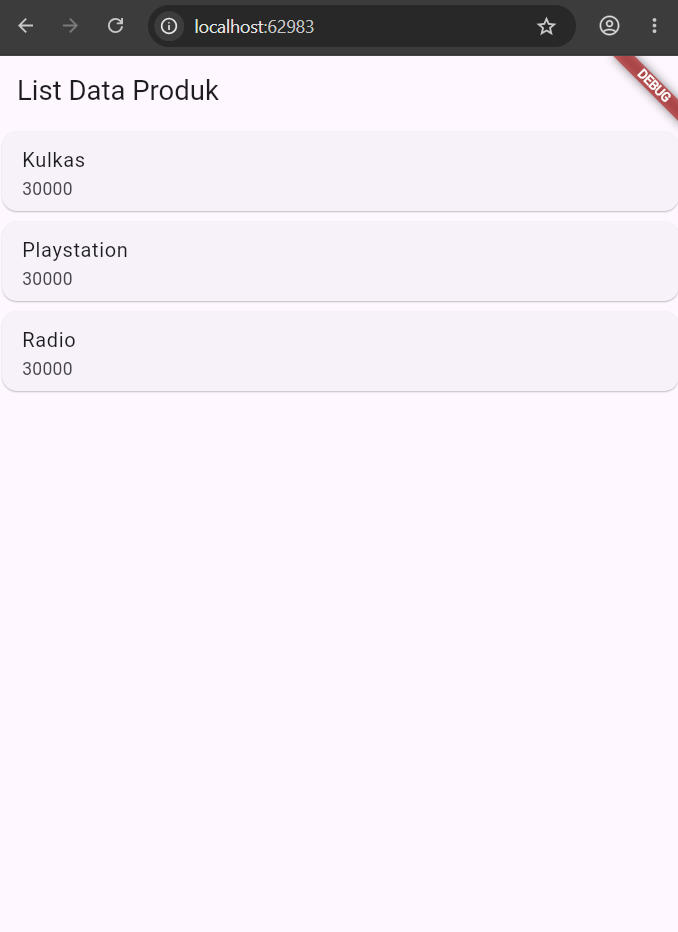

# Praktikum Pemrograman Mobile - Pertemuan 2 Flutter

Tugas praktikum pemrograman mobile pertemuan 2 (Modul 2) mengenai pengenalan framework Flutter dan pembuatan widget dasar (Hello World, Column, Row, Form & Detail Produk, serta List Data Produk).

---

## 📱 Tangkapan Layar (Screenshot)

| Tampilan List Data Produk |
| :---: |
|  |

---

## 🚀 Cara Menjalankan

1. Pastikan Flutter SDK sudah terpasang.
2. Jalankan perintah berikut untuk mengunduh dependensi:
   ```bash
   flutter pub get
   ```
3. Jalankan aplikasi:
   ```bash
   flutter run
   ```
