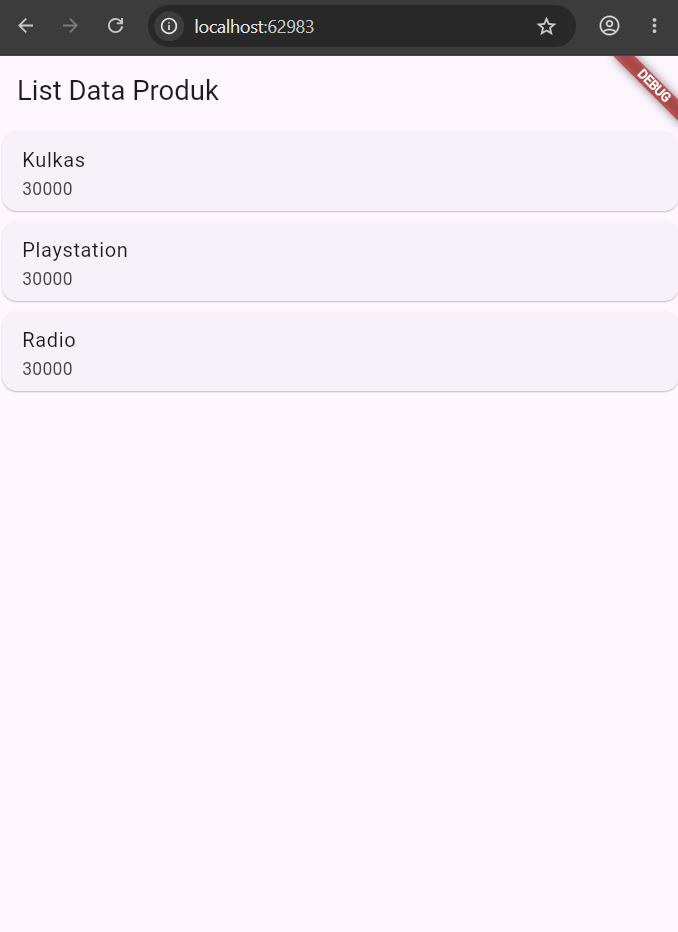

# Praktikum Pemrograman Mobile - Pertemuan 3 Flutter

Tugas praktikum pemrograman mobile pertemuan 3 (Modul 3) mengenai Routes, Side Menu, Login, dan Local Storage menggunakan framework Flutter.

---

## 📱 Tangkapan Layar (Screenshot)

| Tampilan List Data Produk |
| :---: |
|  |

---

## 🚀 Cara Menjalankan

1. Pastikan Flutter SDK sudah terpasang.
2. Jalankan perintah berikut untuk mengunduh dependensi:
   ```bash
   flutter pub get
   ```
3. Jalankan aplikasi:
   ```bash
   flutter run
   ```
